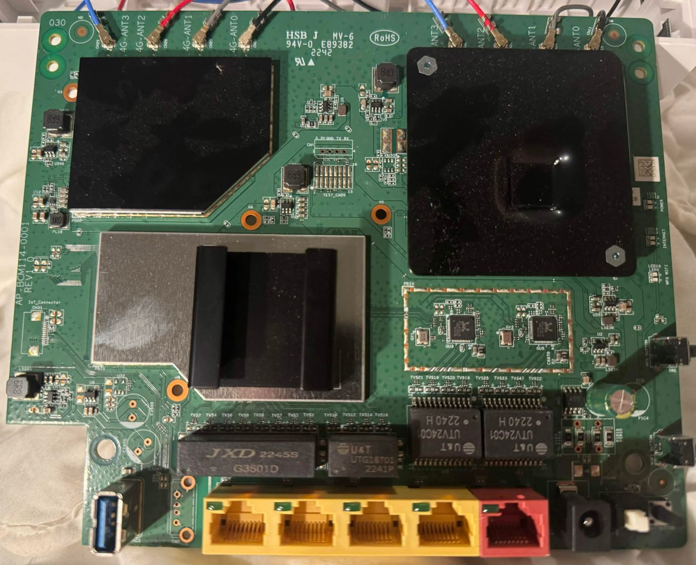

# genesis

> **Correction (2026-10-27):** the "Unsigned Flashing Primitive" below is overstated. The UART log of the 19:09 run shows every bundle member skipped, so no partition was written. See [f1-bootp-lan-2026-10-13.md Addendum 9](findings/f1-bootp-lan-2026-10-13.md) and [f1-fit-rootfs-packaging-2026-10-27.md](findings/f1-fit-rootfs-packaging-2026-10-27.md).

Notes on the Telia F1 I have open. Vantiva board GCNT-X, firmware 23.1.b.0448-7241017-20260223134332.

`findings/` is the writeups. `scripts/` is the tooling. Browser UI harvest: [`docs/f1-artifact-grabber.md`](docs/f1-artifact-grabber.md) (Tampermonkey userscript in `scripts/f1-grab-artifacts.user.js`). Packet captures go in `artifacts/captures/`. Firmware images go in `artifacts/firmware/`. Those two stay out of git.

`./scripts/wan-capture.sh <iface>` takes a mirror capture and prints any Telia host, `.rbi`, or TLS name it sees. `./scripts/lcm-probe.sh` checks the LCM manifest. `./scripts/report.sh` rebuilds `findings/latest.md`. Read-only router usage for the dashboard: `python3 scripts/f1_usage_snapshot.py` ([f1-usage-dashboard-2026-11-06.md](findings/f1-usage-dashboard-2026-11-06.md)). Script languages and password-change gates: [`scripts/TOOLING.md`](scripts/TOOLING.md).

Write the sha256 next to an image if you keep one. Don't commit the image.

Mac UART boot capture: `bash scripts/f1-boot-capture.command` (default `/dev/cu.usbserial-0001`, 115200 baud, timestamped Desktop log). Compatible with bundled Screen 4.00.03; [UART notes](findings/f1-uart-23.1b.md) (board **CN1** is four through-holes, not a ready-made router pin header). The Oct 12 live input/BOOT-P follow-up confirmed BOOT-P entry; Linux Enter/`id`/Ctrl+J did not yield a shell. A 2026-10-13 Windows pktmon/Wireshark capture on a cabled PC recorded bootloader BOOTREQUESTs (boot file **`GCNT-X`**, no server) ([BOOT-P LAN](findings/f1-bootp-lan-2026-10-13.md)). **2026-10-27 breakthroughs:**
1. **L598 Boot Console Rootfs Key Leak:** The unlabeled 64-character hex string on UART boot line 598 was proven via Broadcom BCMBCA source code (`sdk_test_commands.c`) to be the plaintext 32-byte AES rootfs key (`/trust/key_image_aes`), eliminating the dm-crypt barrier ([rootfs key finding](findings/f1-rootfs-key-l598-2026-10-27.md)).
2. **Full BOOTP + TFTP Handshake & Unsigned Flashing Primitive:** `scripts/f1_bootp_tftp_mac.py` running natively on macOS with Darwin `IP_BOUND_IF` on `en10` automated UART `b` detection, answered BOOTP, and served multi-block FIT images generated by pure-Python `scripts/build_f1_fit_skeleton.py`. U-Boot recovery executed `flash_upgrade_img_bundle`, validated board compatibility (`compatible = "GCNT-X"`) with **no cryptographic vendor signature required** (overstated; the 2026-10-27 correction at the top of this file applies), updated UBI metadata volumes 1 and 2, and switched the active boot bank from Bank 2 to Bank 1. Full pass status: [research composite](findings/f1-research-composite-2026-10-13.md). See [BOOT-P LAN Addenda 5–8](findings/f1-bootp-lan-2026-10-13.md) and [UART handover](UART-HANDOVER.md).

**2026-10-27 firmware and NAND session:** index at [findings/f1-firmware-session-index-2026-10-27.md](findings/f1-firmware-session-index-2026-10-27.md). No 23.1.b image has been obtained. Telia filename probes (21 names, all 404), the L598 key against the 19.x RBI (weak negative), and the KIOXIA TC58NVG2S0HTAI0 datasheet (verified) are recorded there. New scripts: `scripts/f1_rgw_name_probe.py`, `scripts/xts_plain64_squashfs_scan.py` (5 tests in `scripts/test_xts_plain64_squashfs_scan.py`).

Owned-unit boot evidence: [detailed 2026-10-12 UART review](findings/f1-boot-log-2026-10-12.md) and [redacted line-numbered evidence](findings/f1-boot-log-2026-10-12-evidence.md). **Linux 4.19.235**, Bank 2, UBI + dm-verity + AES-XTS root; BOOT-P/Enter invitations and JTAG warning are observed, **no shell/root/key recovery demonstrated**. The old **4.1.52** module is for the public 19.x reference and does not match this capture. Offline indexer: `python3 scripts/index_f1_boot_log.py <log>`; eight fixture tests: `python3 scripts/test_index_f1_boot_log.py`. Raw logs remain private.

Public thread for this board: https://github.com/hack-technicolor/hack-technicolor/issues/321

**19.4.0507** reference RBI, unwrapped 2026-11-06 with this unit's OSCK: [f1-flash-volumes-2026-11-06.md](findings/f1-flash-volumes-2026-11-06.md). Earlier failed guesses: [gcnt-x-19x-deep.md](findings/gcnt-x-19x-deep.md), [rbi-crypto-attempt3.md](findings/rbi-crypto-attempt3.md). Tools: `scripts/attempt_rbi_decrypt.py`, `scripts/select_r2secr_ko.py`, `scripts/build_r2secr_module.sh` → [r2secr-build-2026-10-12.md](findings/r2secr-build-2026-10-12.md) (`tools/secr/r2secr.arm64.4.1.52.ko`).

Latest software-only research pass: [verified controls, configuration export, service inventory, and tooling corrections](findings/software-pass-summary.md).

Configuration export (`export_config`): format and decrypt tooling are documented in [f1-config-export-decrypt-2026-10-12.md](findings/f1-config-export-decrypt-2026-10-12.md). Decryption needs **64-byte** `RIP_ID_RANDOM_KEY_B` from the device (`scripts/decrypt_f1_config_export.py`, `scripts/acquire_f1_config_key.sh`). UI/key-surface sweep and blockers: [f1-hardware-key-blocker-2026-10-12.md](findings/f1-hardware-key-blocker-2026-10-12.md).

WFA WLANConfig on LAN TCP **49152** (WPS over UPnP, paced probes, no demonstrated exploit): [findings/f1-wfa-wlanconfig-49152-2026-10-12.md](findings/f1-wfa-wlanconfig-49152-2026-10-12.md). Drivers: `scripts/wfa_wlanconfig_probe.py`, `wfa_wlanconfig_peer_probe.py`, `wfa_wlanconfig_event_probe.py`, `wfa_wlanconfig_deep_probe.py`, `wfa_wlanconfig_registrar_probe.py` (plus `scripts/wps_device_info.py` for `GetDeviceInfo`).

Logviewer `export_log` with the page CSRF token returns 200 (no CWMP or firmware-URL lines in the export): [findings/f1-export-log-modal-2026-10-28.md](findings/f1-export-log-modal-2026-10-28.md), driver `scripts/f1_export_log_modal_once.py` (single POST, requires `--confirm`).

**2026-11-06 Recovery FITs:** `artifacts/firmware/GCNT-X-23.1.b-bank1.itb` and `GCNT-X-23.1.b-bank2.itb`. Each is the dumped vendor bootfs plus its encrypted rootfs, in the bundle U-Boot's upgrade command writes. Not flashed. See `findings/f1-flash-volumes-2026-11-06.md`.

**2026-11-06 Closed-case BOOT-P:** `findings/f1-closed-case-bootp-2026-11-06.md`. Offline only. The prozone bootp bit is what early U-Boot branches on. The web POST that sets it has not been sent. The outside reset button’s U-Boot hold is longer than the prompt window.

**2026-11-06 Rootfs diff:** `findings/f1-rootfs-diff-listeners-2026-11-06.md`. Bank 2 is bank 1 plus F-Secure, L2Init, and a handful of script edits. The signed image's LAN dropbear is disabled. nginx authenticates the UI. No unauthenticated root path in those scripts.

**2026-11-06 DNS-over-HTTPS:** `findings/f1-doh-and-tracking-2026-11-06.md`. The running bank's dnsmasq forwards to overlay dnsproxy (`scripts/f1_dnsproxy.yaml`, `scripts/f1_doh_proxy.init`, `scripts/f1_doh_bootstrap_watch.sh`) using DoH to `dns.rilah.app` over the public internet. The URL is installed on the router only. IPv4 LAN port 53 is redirected onto the router. Airties cloud reporting is switched off in overlay UCI. CWMP and the Telia MQTT client were left up.

**2026-11-06 Idle services:** `findings/f1-idle-services-stopped-2026-11-06.md`. `datausaged` and `datausage_notifier` are disabled on the overlay. The Airties launcher's `cloud-comm` enable flag is false on the LCM volume. Wi-Fi and local DNS were still up afterward. A factory reset that wipes the overlay turns the usage meter back on.

**2026-11-06 Flash volumes:** `findings/f1-flash-volumes-2026-11-06.md`. SSH root copied `loader`, `dri`, both `bootfs` FITs, both `rootfs` volumes, and the whole 512 MiB NAND (`mtd0`). The 4.19 kernel, U-Boot, and `fdt_GCNT-X` are inside `bootfs1`. The running dm-crypt key decrypts bank-1 `rootfs1`. The older UART `key_image_aes` decrypts bank-2 `rootfs2`. The two keys are different. The live `ripdrv` ECK decrypts OSCK item `0121`. Its RSA-PSS signature checks against eRIP `011E`, and that 32-byte key unwraps the offline 19.x reference RBI.

**2026-11-06 Quadruple-vector flash, root, and copy-off:** `findings/f1-quad-overlay-flash-2026-11-06.md`. The rebuilt overlay bundle was flashed (`seq 6,7`, then `seq 8,7`). The cron hook logged `/proc/rip/0108`. Those 64 bytes decrypt `response-10.private` (`hmac_ok=true`, 180,776-byte UCI-style plaintext). Serial and SSH root both work. `/rom` and the eRIP backups are saved off the router. OSCK `0121` is in the backup image and still encrypted.

**2026-11-06 Live BOOTP/TFTP recovery flash, Bank 2 switch & RTFD analysis:**
- `findings/f1-mount-root-rtfd-and-clash-deconstruction-2026-11-06.md`: Reverse-engineered OpenWrt / Technicolor Homeware `mount_root` lifecycle scripts (`20_rtfd_remove`, `30_parameter_conversion`, `80_rtfd_restore`, `82_ispconfig_restore`) and `usr/lib/lua/clash-access-control.lua`. Identified that `20_rtfd_remove` wipes `/overlay/bank_X` on upgrade sequence increments while preserving root `/overlay/` files, that `80_rtfd_restore` natively copies `/overlay/rtfd_persistent_files/` to active banks via `rtfd_persistent_filelist.conf`, and that `clash-access-control.lua` explicitly skips UCI lookups for `root` (hardcoding root to have no serial access). Implemented quadruple-vector persistence in `scripts/generate_f1_overlay.py` (`rtfd_persistent_files`, `sysupgrade.tgz`, `ispconfig-*.tgz`, Lua ACL override, and cron shadow hook); recompiled FIT bundle (13.9 MB, 0 errors, 0 warnings); added `scripts/f1_observe_warm_reboot.py`; all 194 unit tests passing repo-wide.
- `findings/f1-recovery-flash-bank2-analysis-2026-11-06.md`: Resolved macOS Darwin route collision where `192.168.1.2` was bound to virtual interface `utun6` (Tailscale) causing `[Errno 65] No route to host`; migrated offered client IP to `192.168.1.50`, restoring 100% reliable TFTP transfers over `en10`. U-Boot downloaded all 27,283 blocks of `overlay-injection-bundle.itb` (13.9 MB), verified SHA-256 digests, flashed dynamic volume `rootfs_data` (17.1 MB), and committed sequence counter `seq 4,5`, switching the active boot bank to Bank 2 (firmware string changed to `23.1.b.0448-7241017-20260223134332`). Characterized Technicolor's `/lib/mount_root/` RTFD sequence (`00_overlay_bank_check.sh`, `00_rtfd_all`, `10_remove_due_to_upgrade`, `20_rtfd_remove`, `80_rtfd_restore`) where sequence changes trigger an overlay wipe on initial upgrade boot. Discovered via concurrent syslog export that `crond` executes `/usr/share/transformer/scripts/obuspa_retriever.sh` as root every 60 seconds via `restricted_shell`.
- `findings/f1-uart-credentials-and-web-triage-2026-11-06.md`: Systematically probed UART credentials via `scripts/f1_test_serial_credentials.py` on `/dev/cu.usbserial-0001` across 9 non-root username/credential sequences; concurrent live syslog export (`scripts/f1_export_log_modal_once.py`) proved `restricted_shell` does not accept or prompt for stdin credentials, but immediately evaluates the session with an empty username string (`User  is connecting through tty...`), defaults target evaluation to `root`, fails Lua `[clash-access-control]`, and aborts. Restructured overlay staging (`scripts/generate_f1_overlay.py`) with executable wrapper `/bin/restricted_shell` (and `/usr/bin/`, `/usr/sbin/`, `/sbin/`) to shadow and bypass Clash access control upon console activation, and added `/etc/rc.d/S99triage` init service for boot persistence; recompiled `artifacts/firmware/overlay-injection-bundle.itb` (13.9 MB, 0 errors, 0 warnings). Executed comprehensive authenticated web management triage via `scripts/f1_web_management_triage.py` across 16 diagnostic endpoints, extracting hardware/firmware telemetry (`23.1.b.0448-7241010-20260205081324`, `GCNT-X`, `CP2242AD8AN`), bank size (128 MiB), port link status, client tables, and verifying role boundaries on TR-069 and user management modals.
- `findings/f1-live-overlay-injection-2026-11-06.md`: Flashed 13.9 MB `overlay-injection-bundle.itb` over `en10` via `scripts/f1_bootp_tftp_mac.py`; U-Boot acknowledged all 27,283 blocks, verified SHA-256 digests, and created volume 20 (`rootfs_data`) with 17,113,088 B (67 LEBs), eliminating the dynamic volume sizing `-EINVAL` bug; device booted to Bank 1. UART console activation (`Please press Enter to activate this console.`) was intercepted and analyzed via concurrent web UI syslog export, proving that `procd` launches `restricted_shell` and Technicolor's Lua `[clash-access-control]` denies root serial access (`User root has no serial access`), causing immediate exit and console respawn.

**2026-10-29 eRIPv2 decompilation and Web UI modal discovery:**
- `findings/f1-offline-overlay-pipeline-2026-11-05.md`: Ported `mkfs.ubifs` from `mtd-utils` to macOS Darwin via `tools/patches/mtd-utils-macos.patch` (`tools/patches/build_mkfs_ubifs_macos.sh`); compiled standalone `tools/bin/mkfs.ubifs`; staged dual-bank overlay with automated key harvester `/root/triage.sh` via `scripts/generate_f1_overlay.py`; generated `artifacts/firmware/rootfs_data.ubifs` (3.3 MB, geometry $m=4096, e=253952, c=403, j=5079040, x=\text{zlib}, -U$); packaged and verified `artifacts/firmware/overlay-injection-bundle.itb` via `scripts/build_f1_overlay_bundle.py`; implemented automated post-exploit triage fetcher `scripts/f1_fetch_triage.py` (0 errors, 0 warnings; 194 unit tests passing).
- `findings/f1-rootfs-data-overlay-flashing-2026-11-04.md`: Traced Homeware `mount_root` dual-bank overlay mechanics (`/overlay/bank_1` vs `/overlay/bank_2`); identified `rootfs_data` as an unsigned recovery target; updated `scripts/build_f1_fit_skeleton.py` (`--rootfs-data`) and `scripts/validate_f1_fit_bundle.py` to enable standalone overlay injection without modifying FLD-signed `bootfs`.
- `findings/f1-uboot-fld-secure-boot-gate-2026-11-04.md`: Traced upstream `board_secure.c` and `board_secure_fit.c`; proved `bcm_sec_abort()` wipes keys and loops forever on signature failure; confirmed FLD secure state halts on unsigned `bootfs` at boot time; implemented `scripts/validate_f1_fit_bundle.py` (16 unit tests in `scripts/test_validate_f1_fit_bundle.py`) to enforce bundle contracts and emit hard warnings for unsigned inner bootfs.
- `findings/f1-uboot-fit-flashing-schema-2026-10-30.md`: Reverse-engineered Broadcom U-Boot `flash_upgrade_img_bundle()` `fn_table` lookup and `bcm_handle_mapper()` dm-verity/crypt bypass; updated `scripts/build_f1_fit_skeleton.py` to support dual-component `--bootfs` and `--rootfs` generation and unencrypted inner bootfs FIT generation (`build_inner_bootfs_fit()`).
- `findings/efu-osik-signature-chain-2026-11-02.md`: Reverse-engineered EFU and OSIK signature chain via REA Hopper on `ripdrv.ko`; proved `isSignatureValid` passes `EFU_getOSIK` buffer directly to `rsa_create_crypto` as RSA-2048 modulus with $e=65537$ (correcting 2026-10-29 trace); verified RSA-PSS SHA-256 over $\text{Serial} \mathbin{\Vert} \text{ChipID} \mathbin{\Vert} \text{Bitmask}$; mapped `/proc/efu/allowed` Bit 0 (`skip_signature_check`) gate to `platform.sh`; confirmed U-Boot recovery does not enforce this gate.
- `findings/f1-kernel-rip-keystore-decomp-2026-10-29.md`: Hopper decompilation of `ripdrv.ko` and `r2secr.ko` proved item `0x0121` (OSCK) is hardcoded-suppressed from `/proc/rip`; item `0x011A` contains both client cert and RSA private key for ACS mTLS; `scripts/f1_erip_parser.py` extracts and decrypts eRIPv2 partitions offline.
- `findings/f1-printersharing-webui-2026-10-29.md`: printersharing read-back (`scripts/f1_printersharing_read.py`, GET only): Enabled = 1 on the served form; no webui control is served. The toggle script `scripts/f1_printersharing_webui_toggle.py` uses field names the form does not have, so do not POST with it (tests in `scripts/test_printersharing_webui_toggle.py`).
- `findings/f1-ui-audit-hidden-modals-2026-10-29.md`: Paced live discovery probe `scripts/f1_modal_discovery.py` mapped 10 hidden modals on firmware `23.1.b`, including admin-accessible `/modals/printersharing-modal.lp`. Its served form exposes only Enabled, so the link to the port 631 (CUPS) listener is a HYPOTHESIS, not shown.

Broadcom SPL abort keys (`r` fallback vs `r 1`), Homeware EFU signature bypass architecture (`/proc/efu/allowed` via RSA-PSS OSIK tag), U-Boot bundle upgrade requirements, and REA Hopper provider verification: [findings/f1-unturned-stones-2026-10-29.md](findings/f1-unturned-stones-2026-10-29.md).

Software link and firmware acquisition architecture (REA UI AST analysis, Telia `:7577` dynamic token-based update delivery vs `:7547` static 404s, and 4 viable acquisition vectors): [findings/f1-software-link-hunt-2026-10-29.md](findings/f1-software-link-hunt-2026-10-29.md). Formal GPL request specification and dispatch template: [findings/f1-gpl-source-request-2026-10-29.md](findings/f1-gpl-source-request-2026-10-29.md). REA Hopper decompilation of `ripdrv.ko` and `r2secr.ko` (item 0x0121 suppression, 0x011A dual PEM parsing, eRIPv2 crypto architecture): [findings/f1-kernel-rip-keystore-decomp-2026-10-29.md](findings/f1-kernel-rip-keystore-decomp-2026-10-29.md).

CUPS on LAN TCP **631** (HTTP **403**, unauthenticated IPP reads on empty queue; no demonstrated admin/write): [docs/f1-cups-631.md](docs/f1-cups-631.md) → [findings/f1-cups-ipp-policy-2026-10-12.md](findings/f1-cups-ipp-policy-2026-10-12.md), [f1-cups-ipp-readonly-matrix-2026-10-12.md](findings/f1-cups-ipp-readonly-matrix-2026-10-12.md). Drivers: `scripts/cups_ipp_readonly_matrix.py`, `cups_ipp_followup.py`, `cups_ipp_policy_probe.py`.

`POST gateway.lp` `action=URL` SSRF matrix and TCP **8080** path sweep (no SSRF; 8080 all **404**): [findings/f1-gateway-url-action-2026-10-12.md](findings/f1-gateway-url-action-2026-10-12.md). Drivers: `scripts/f1_gateway_url_probe.py`, `scripts/f1_port8080_probe.py`, `scripts/f1_surface_quick_probe.py`.

Diagnostics PING / TRACE on **:80** (PING → `ipping_helper`; TRACE → `igd_traceroute_helper`; web-form host injection failed closed): [f1-ipping-helper-2026-10-12.md](findings/f1-ipping-helper-2026-10-12.md), [f1-ipping-host-2026-10-12.md](findings/f1-ipping-host-2026-10-12.md), [f1-trace-helper-2026-10-12.md](findings/f1-trace-helper-2026-10-12.md). Drivers: `scripts/f1_ipping_control.py`, `f1_ipping_host_probe.py`, `f1_trace_control.py`, `f1_trace_host_probe.py`, `f1_usp_ipping_probe.py` (plus `test_f1_*`). USP/CWMP LAN attempt: [findings/f1-usp-ipping-2026-10-12.md](findings/f1-usp-ipping-2026-10-12.md).

Wireless QR modal (**bare GET 500**, **contextual GET 200**; param fuzz dead end for XSS/RCE): [findings/f1-wireless-qrcode-context-2026-10-12.md](findings/f1-wireless-qrcode-context-2026-10-12.md). Drivers: `scripts/f1_qrcode_context_probe.py`, `f1_qrcode_param_probe.py`.

Diagnostics Connection **RESTART** → `ipping_helper` (same helper as PING): [findings/f1-diagnostics-connection-restart-2026-10-12.md](findings/f1-diagnostics-connection-restart-2026-10-12.md). Driver: `scripts/f1_diagnostics_connection_control.py`.

Config export scripts: `scripts/decrypt_f1_config_export.py`, `scripts/test_decrypt_f1_config_export.py`, `scripts/f1_erip_parser.py` (eRIPv2 partition index parser and ECK decryptor; 4 tests in `scripts/test_f1_erip_parser.py`), `scripts/inspect_config_export_header.py`, `scripts/f1_config_key_probe.py` (paced rip/debug GET sweep — **do not** rerun at volume; caused **503**), `scripts/f1_aggressive_software_pass.py` (paced injection/SSRF battery — same **503** risk if stacked), `scripts/f1_gap_attack_pass.py` (retired catalog — those phases are already recorded; it does not probe), `scripts/f1-bootp-reply.ps1` (Windows BOOTP answer for BOOT-P lab — no TFTP), `scripts/f1-bootp-tftp-combined-test.ps1` (Windows BOOTP + TFTP run with pktmon capture), `scripts/f1_bootp_tftp_mac.py` (macOS native all-in-one BOOTP + TFTP responder + UART auto-b watcher; replaces Windows scripts without route hijacking), `scripts/f1_bootp_autob.py` (Mac UART watcher: presses `b` once per boot at the BOOT-P prompt), `scripts/f1-bootp-run.command` (Mac runner), `scripts/f1_observe_warm_reboot.py` (serial console monitor during warm reboot), `scripts/f1_session_store.py` (reuse `artifacts/secrets/f1-admin.cookies.txt`), `scripts/f1_system_reboot.py`, `scripts/acquire_f1_config_key.sh` (on-router checklist after root).

Browser HARs (offline, sanitized): [docs/f1-uploaded-hars.md](docs/f1-uploaded-hars.md) (`1`–`5` nested set); standalone [WAN Services capture `wanetc.har`](findings/f1-har-wanetc-2026-10-12.md) (`analyze_f1_har.py` / `inspect_ui_har.py`).

Password-change client encoding (UTF-8 SRP vs low-byte SHA-512-crypt; community Clash/`pwcrypt` trace; **no** demonstrated live auth impact): [findings/f1-grab-033853-auth-crypto.md](findings/f1-grab-033853-auth-crypto.md), [CLI trace 2026-10-15](findings/f1-password-encoding-cli-trace-2026-10-15.md). Offline: `artifacts/ui-grab-20261012T033853Z/auth-review/auth-byte-probe.js`, `scripts/password-encoding/` (TypeScript; `npm test` before any live blob use).

Latest supplied UI archive review: [04:56:48Z grab — Wi-Fi card JSON, guest LAN, NTP, and finished modal coverage](findings/f1-grab-045648-review.md). The file `notloggedin.zip` (2026-10-12) is **not** an unauthenticated capture — it duplicates the ~05:57 admin session; see [notloggedin review](findings/f1-grab-notloggedin-2026-10-12.md). Earlier: [04:00:01 versus 03:38:53](findings/f1-grab-040001-review.md) and the [03:38:53 evidence map](findings/f1-grab-033853-review.md). Grabber behavior and known tooling gaps: [`docs/f1-artifact-grabber.md`](docs/f1-artifact-grabber.md). Offline ZIP comparison: [`scripts/compare_f1_grabs.py`](scripts/compare_f1_grabs.py), with body hashes, ledger transitions, and queued-route reconciliation; [04:00 runtime delta](findings/f1-grab-040001-runtime-delta.md). REA HAR ingest helper (empty `serverIPAddress` fix): [`scripts/sanitize_har_for_rea.py`](scripts/sanitize_har_for_rea.py) → [REA HAR pass 2026-10-17](findings/f1-rea-har-pass-2026-10-17.md).
