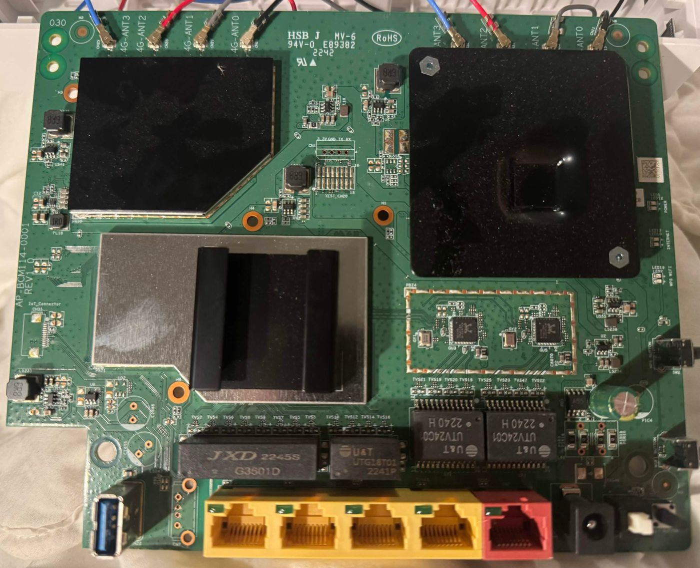

# genesis

Notes on the Telia F1 I have open. Vantiva board GCNT-X, firmware 23.1.b.0448-7241017-20260223134332.

`findings/` is the writeups. `scripts/` is the tooling. Browser UI harvest: [`docs/f1-artifact-grabber.md`](docs/f1-artifact-grabber.md) (Tampermonkey userscript in `scripts/f1-grab-artifacts.user.js`). Packet captures go in `artifacts/captures/`. Firmware images go in `artifacts/firmware/`. Those two stay out of git.

`./scripts/wan-capture.sh <iface>` takes a mirror capture and prints any Telia host, `.rbi`, or TLS name it sees. `./scripts/lcm-probe.sh` checks the LCM manifest. `./scripts/report.sh` rebuilds `findings/latest.md`.

Write the sha256 next to an image if you keep one. Don't commit the image.

Mac UART boot capture: `bash scripts/f1-boot-capture.command` (default `/dev/cu.usbserial-0001`, 115200 baud, timestamped Desktop log). Compatible with bundled Screen 4.00.03; [UART notes](findings/f1-uart-23.1b.md).

Owned-unit boot evidence: [detailed 2026-10-12 UART review](findings/f1-boot-log-2026-10-12.md) and [redacted line-numbered evidence](findings/f1-boot-log-2026-10-12-evidence.md). **Linux 4.19.235**, Bank 2, UBI + dm-verity + AES-XTS root; BOOT-P/Enter invitations and JTAG warning are observed, **no shell/root/key recovery demonstrated**. The old **4.1.52** module is for the public 19.x reference and does not match this capture. Offline indexer: `python3 scripts/index_f1_boot_log.py <log>`; eight fixture tests: `python3 scripts/test_index_f1_boot_log.py`. Raw logs remain private.

Public thread for this board: https://github.com/hack-technicolor/hack-technicolor/issues/321

Sealed **19.4.0507** reference RBI (offline decrypt blocked on GCNT-X OSCK): [gcnt-x-19x-deep.md](findings/gcnt-x-19x-deep.md), [rbi-crypto-attempt3.md](findings/rbi-crypto-attempt3.md). Tools: `scripts/attempt_rbi_decrypt.py`, `scripts/select_r2secr_ko.py`, `scripts/build_r2secr_module.sh` → [r2secr-build-2026-10-12.md](findings/r2secr-build-2026-10-12.md) (`tools/secr/r2secr.arm64.4.1.52.ko`).

Latest software-only research pass: [verified controls, configuration export, service inventory, and tooling corrections](findings/software-pass-summary.md).

Configuration export (`export_config`): format and decrypt tooling are documented in [f1-config-export-decrypt-2026-10-12.md](findings/f1-config-export-decrypt-2026-10-12.md). Decryption needs **64-byte** `RIP_ID_RANDOM_KEY_B` from the device (`scripts/decrypt_f1_config_export.py`, `scripts/acquire_f1_config_key.sh`). UI/key-surface sweep and blockers: [f1-hardware-key-blocker-2026-10-12.md](findings/f1-hardware-key-blocker-2026-10-12.md).

WFA WLANConfig on LAN TCP **49152** (WPS over UPnP, paced probes, no demonstrated exploit): [findings/f1-wfa-wlanconfig-49152-2026-10-12.md](findings/f1-wfa-wlanconfig-49152-2026-10-12.md). Drivers: `scripts/wfa_wlanconfig_probe.py`, `wfa_wlanconfig_peer_probe.py`, `wfa_wlanconfig_event_probe.py`, `wfa_wlanconfig_deep_probe.py`, `wfa_wlanconfig_registrar_probe.py` (plus `scripts/wps_device_info.py` for `GetDeviceInfo`).

CUPS on LAN TCP **631** (HTTP **403**, unauthenticated IPP reads on empty queue; no demonstrated admin/write): [docs/f1-cups-631.md](docs/f1-cups-631.md) → [findings/f1-cups-ipp-policy-2026-10-12.md](findings/f1-cups-ipp-policy-2026-10-12.md), [f1-cups-ipp-readonly-matrix-2026-10-12.md](findings/f1-cups-ipp-readonly-matrix-2026-10-12.md). Drivers: `scripts/cups_ipp_readonly_matrix.py`, `cups_ipp_followup.py`, `cups_ipp_policy_probe.py`.

`POST gateway.lp` `action=URL` SSRF matrix and TCP **8080** path sweep (no SSRF; 8080 all **404**): [findings/f1-gateway-url-action-2026-10-12.md](findings/f1-gateway-url-action-2026-10-12.md). Drivers: `scripts/f1_gateway_url_probe.py`, `scripts/f1_port8080_probe.py`, `scripts/f1_surface_quick_probe.py`.

Diagnostics PING / TRACE on **:80** (PING → `ipping_helper`; TRACE → `igd_traceroute_helper`; web-form host injection failed closed): [f1-ipping-helper-2026-10-12.md](findings/f1-ipping-helper-2026-10-12.md), [f1-ipping-host-2026-10-12.md](findings/f1-ipping-host-2026-10-12.md), [f1-trace-helper-2026-10-12.md](findings/f1-trace-helper-2026-10-12.md). Drivers: `scripts/f1_ipping_control.py`, `f1_ipping_host_probe.py`, `f1_trace_control.py`, `f1_trace_host_probe.py`, `f1_usp_ipping_probe.py` (plus `test_f1_*`). USP/CWMP LAN attempt: [findings/f1-usp-ipping-2026-10-12.md](findings/f1-usp-ipping-2026-10-12.md).

Wireless QR modal (**bare GET 500**, **contextual GET 200**; param fuzz dead end for XSS/RCE): [findings/f1-wireless-qrcode-context-2026-10-12.md](findings/f1-wireless-qrcode-context-2026-10-12.md). Drivers: `scripts/f1_qrcode_context_probe.py`, `f1_qrcode_param_probe.py`.

Diagnostics Connection **RESTART** → `ipping_helper` (same helper as PING): [findings/f1-diagnostics-connection-restart-2026-10-12.md](findings/f1-diagnostics-connection-restart-2026-10-12.md). Driver: `scripts/f1_diagnostics_connection_control.py`.

Config export scripts: `scripts/decrypt_f1_config_export.py`, `scripts/test_decrypt_f1_config_export.py`, `scripts/inspect_config_export_header.py`, `scripts/f1_config_key_probe.py` (paced rip/debug GET sweep — **do not** rerun at volume; caused **503**), `scripts/acquire_f1_config_key.sh` (on-router checklist after root).

Browser HARs (offline, sanitized): [docs/f1-uploaded-hars.md](docs/f1-uploaded-hars.md) (`1`–`5` nested set); standalone [WAN Services capture `wanetc.har`](findings/f1-har-wanetc-2026-10-12.md) (`analyze_f1_har.py` / `inspect_ui_har.py`).

Latest supplied UI archive review: [04:56:48Z grab — Wi-Fi card JSON, guest LAN, NTP, and finished modal coverage](findings/f1-grab-045648-review.md). The file `notloggedin.zip` (2026-10-12) is **not** an unauthenticated capture — it duplicates the ~05:57 admin session; see [notloggedin review](findings/f1-grab-notloggedin-2026-10-12.md). Earlier: [04:00:01 versus 03:38:53](findings/f1-grab-040001-review.md) and the [03:38:53 evidence map](findings/f1-grab-033853-review.md). Grabber behavior and known tooling gaps: [`docs/f1-artifact-grabber.md`](docs/f1-artifact-grabber.md). Offline ZIP comparison: [`scripts/compare_f1_grabs.py`](scripts/compare_f1_grabs.py), with body hashes, ledger transitions, and queued-route reconciliation; [04:00 runtime delta](findings/f1-grab-040001-runtime-delta.md).
