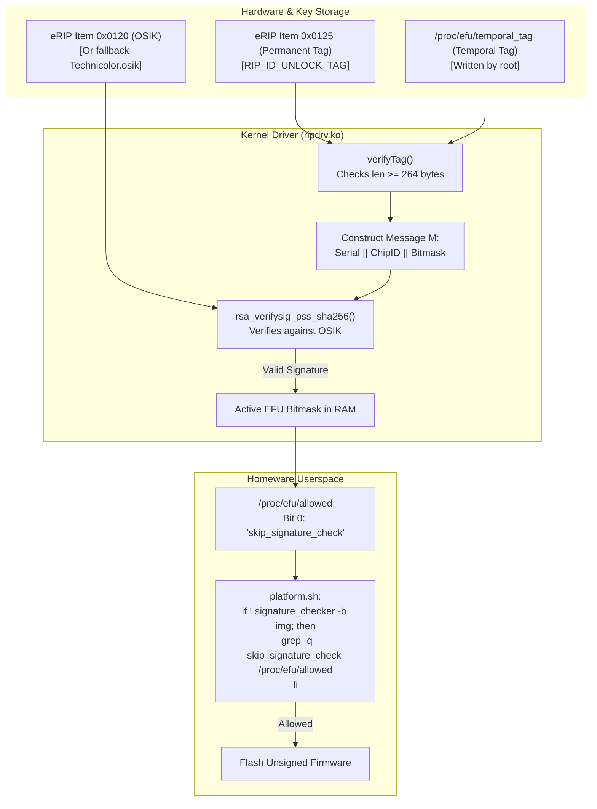

# EFU & OSIK Cryptographic Signature Chain Analysis (2026-11-02)

## Purpose and Scope

Resolve the cryptographic signature chain governing Technicolor / Vantiva Homeware's **Engineering Feature Unlock (EFU)** mechanism and the **Operating System Integrity Key (OSIK)** (`RIP_ID_OSIK`, Item `0x0120`).

This analysis establishes ground truth on:
1. How `/proc/efu/allowed` and `/proc/efu/temporal_tag` operate in kernel space.
2. The exact message format and cryptographic primitives used in tag verification.
3. The resolution of the open question in [efu-info-proc-2026-10-29.md](efu-info-proc-2026-10-29.md) regarding whether OSIK is the RSA verification key.
4. How the EFU gate links to userspace firmware upgrade validation (`platform.sh` and `signature_checker`).

**Target Artifact:** `tools/secr/ripdrv.arm.3.4.11-rt19.ko` (SHA-256: `94b7ad31e3d75cdf6c0f31814c1cc45aa0237d8f3d959df15a8c2257bebe73c1`).  
**Tooling:** REA MCP provider (`hopper`), `aarch64-linux-gnu-objdump`, `rizin`.  
**Exploit Status:** None. Cryptographic audit and binary reverse engineering only.

---

## 1. Key Resolution: Correction to 2026-10-29 Trace (VERIFIED)

In [efu-info-proc-2026-10-29.md](efu-info-proc-2026-10-29.md), Section 8 ("Key buffer trace"), it was hypothesized that the 256-byte buffer populated by `EFU_getOSIK` was unused and that the RSA key source was "UNKNOWN / uninitialised".

**Correction (VERIFIED by instruction disassembly and Hopper decompiler):**
The OSIK buffer **is** directly and unequivocally passed as the verification key:

1. In `isSignatureValid` (`0x21a8`):
   ```assembly
   0x2254: add r0, sp, #0x10    ; r0 = sp + 0x10 (stack buffer)
   0x2258: mov r1, r4           ; r1 = 0x100 (256 bytes)
   0x225c: bl  EFU_getOSIK      ; EFU_getOSIK(sp + 0x10, 256)
   ...
   0x2270: bl  kmem_cache_alloc ; allocates RSA context (r6)
   ...
   0x227c: add r0, sp, #0x10    ; r0 = sp + 0x10 (SAME OSIK buffer!)
   0x2280: mov r1, #0x2         ; r1 = 2 (RSA-2048 public key mode)
   0x2284: mov r2, r6           ; r2 = RSA context pointer
   0x2288: movw r3, #0x588      ; r3 = context size check
   0x228c: bl  rsa_create_crypto; rsa_create_crypto(osik_buf, 2, ctx, 0x588)
   ```

2. Inside `rsa_create_crypto` (`0x2bf0`):
   ```assembly
   0x2bf8: push {r4, r5, r6, r7, r8, lr}
   0x2bfc: mov  r7, r1          ; r7 = key_type (2)
   0x2c00: mov  r8, r0          ; r8 = key_buf (OSIK buffer)
   0x2c0c: mov  r4, r2          ; r4 = RSA context
   ...
   0x2c2c: add  r6, r4, #0x4    ; r6 = &ctx->modulus
   0x2c30: add  r5, r4, #0x14   ; r5 = &ctx->exponent
   0x2c34: mov  r0, r6
   0x2c38: bl   mp_init
   0x2c3c: mov  r0, r5
   0x2c40: bl   mp_init
   0x2c44: cmp  r7, #0x2
   0x2c48: mov  r1, r8          ; r1 = OSIK key buffer!
   0x2c54: moveq r3, #0x800     ; 2048 bits
   0x2c5c: moveq r2, #0x100     ; 256 bytes
   0x2c60: mov  r0, r6          ; r0 = &ctx->modulus
   0x2c6c: bl   mp_read_unsigned_bin ; reads 256 bytes from OSIK into modulus
   0x2c74: mov  r0, r5          ; r0 = &ctx->exponent
   0x2c78: movt r1, #0x1        ; r1 = 0x10001 (65537)
   0x2c7c: bl   mp_set_int      ; sets exponent e = 65537
   ```

**Conclusion:** `isSignatureValid` initializes a 2048-bit RSA public key context with modulus $n = \text{OSIK}$ and public exponent $e = 65537$.

---

## 2. OSIK Key Provenance and Fallback (VERIFIED)

In `EFU_getOSIK` (`0x2164`):
```c
r0 = rip2_drv_read(&len, 0x120, buf);
if (r0 != 1) {
    memcpy(buf, fallback_table, len);
}
```
1. `rip2_drv_read` attempts to read eRIP Item `0x0120` (`RIP_ID_OSIK`).
2. If the item is missing or read fails, it copies 256 bytes from `.rodata` offset `0x37f8`.
3. Binary comparison confirms that the fallback table is **byte-for-byte identical to `tools/hack-technicolor/osik/Technicolor.osik`** (SHA-256: `1a8b5f07...`, starts with `d9a2aecb`).
4. On systems with an operator-specific OSIK (e.g., `Telia.osik`, starts with `c4f0de2d`), Item `0x0120` in the encrypted eRIP partition overrides the fallback table.

---

## 3. EFU Tag Binary Format & Verification Algorithm (VERIFIED)

### Tag Structure (minimum 264 bytes)
| Offset | Length | Name | Description |
|---|---|---|---|
| `0x000` | 256 B | `signature` | RSA-PSS SHA-256 signature generated by vendor/operator private key |
| `0x100` | 8 B | `bitmask` | 64-bit big-endian bitmask defining enabled engineering features |
| `0x108` | Variable | `tag_payload` | Optional extension payload (minimum length 0) |

### Active Feature Bits (`rip_efu_allowed_show`, `0x27f4`)
- **Bit 0 (`mask & 0x01`):** `skip_signature_check\n`
- **Bit 1 (`mask & 0x02`):** `skip_variantid_check\n`
- **Bit 2 (`mask & 0x04`):** `downgrade_restricition\n` [sic]

### Signed Message Construction (`isSignatureValid`, `0x21a8`)
The signed message $\mathcal{M}$ is constructed dynamically in kernel memory:
$$\mathcal{M} = \text{Serial\_Number} \mathbin{\Vert} \text{Chip\_ID}_{32\text{BE}} \mathbin{\Vert} \text{Tag\_Payload}_{8+\text{bytes}}$$

Where:
- $\text{Serial\_Number}$: Concatenation of eRIP Item `0x003C` (`RIP_ID_FACTORY_ID`, e.g. `"CP"`) and `0x0012` (`RIP_ID_BOARD_SERIAL_NBR`, e.g. `"2245..."`). Null-terminated ASCII string, length `strlen(Serial_Number)`.
- $\text{Chip\_ID}_{32\text{BE}}$: 4 bytes big-endian integer returned by `otp_chipid_read()`.
- $\text{Tag\_Payload}$: The bytes starting at tag offset `0x100` (the 8-byte bitmask plus any additional payload bytes).

### Signature Verification Primitives
- **Digest:** SHA-256 computed over message $\mathcal{M}$.
- **Padding:** PKCS#1 v2.1 PSS (`rsa_verifysig_pss` calling LibTomCrypt `rsa_verify_hash_ex`).
- **Key:** RSA-2048 public key $(n = \text{OSIK}, e = 65537)$.

If verification succeeds, `isSignatureValid` prints `== SIG VALID ==\n` and returns 1. If it fails, it prints `== ! SIG INV ! ==\n` and returns 0.

---

## 4. End-to-End Signature Chain Architecture



---

## 5. Architectural Implications for Research

1. **Cryptographic Security of EFU:**
   Because tag verification uses standard RSA-PSS SHA-256 with a 2048-bit modulus tied to the hardware serial and OTP chip ID:
   - Tags cannot be forged without the private key corresponding to OSIK.
   - Tags cannot be replayed from another device (the serial number and chip ID are bound into the signed digest).
   - The public keys in `tools/hack-technicolor/osik/` allow **verifying** existing signatures offline, but cannot **create** valid signatures.

2. **Decoupling from Bootloader Recovery:**
   As demonstrated in [f1-uboot-fit-flashing-schema-2026-10-30.md](f1-uboot-fit-flashing-schema-2026-10-30.md), Broadcom U-Boot's low-level recovery flasher (`flash_upgrade_img_bundle`) operates entirely outside this chain:
   - U-Boot writes raw partition bytes directly via UBI.
   - It does not invoke `signature_checker` or consult `/proc/efu/allowed`.
   - The EFU/OSIK gate is purely a **Homeware Linux userspace and kernel protection**, not a hardware secure-boot requirement on this Broadcom platform.

3. **Kernel Differences:**
   The analyzed binary is an ARMv7 Linux 3.4.11 module (`ripdrv.arm.3.4.11-rt19.ko`). The live Telia F1 unit runs Linux 4.19.235 AArch64. While the eRIP IDs and Homeware script architecture (`platform.sh`) match across versions, live `/proc/efu` nodes are not reachable unauthenticated over LAN.

---

## What Was Not Shown
- Possession of any private key corresponding to `Technicolor.osik` or `Telia.osik`.
- Any cryptographic bypass or signature malleability in LibTomCrypt's RSA-PSS SHA-256 implementation.
- Live `/proc/efu` inspection on the 23.1.b F1 device (requires local shell).
