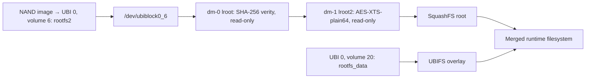

# Owned F1 UART boot capture — detailed evidence review, 2026-10-12

**Scope update:** this document records the initial *offline* review of the 86,162-byte source capture. Its proposed “resolve serial activation” experiment was later performed live. See [UART interaction/BOOT-P follow-up](f1-uart-interaction-2026-10-12.md) for the newer capture, tested keys, no-Ethernet BOOT-P timeout, and current limits; do not treat the offline-pass “not tested” statements below as current status.

## Result and scope

**VERIFIED in the supplied bytes:** GCNT-X / BCM68360_B1 boots through SPL, DDR initialization, TPL, U-Boot and Linux **4.19.235**, selects **Bank 2**, authenticates FIT headers, creates a **verity → crypt → SquashFS** root-device stack, mounts a separate UBIFS overlay, and reaches userspace/wireless initialization. The capture contains both `*** Press b to enter BOOT-P ***` and `Please press Enter to activate this console.` Neither was exercised in this review.

**VERIFIED correction:** the existing `r2secr.arm64.4.1.52.ko` targets the older public **19.4.0856** reference, not this kernel. The offline selector returns `arch=aarch64 no_module_match`, exit **1**, on this full log. No module was loaded.

**VERIFIED messages requiring follow-up:** SPL warns `JTAG UNLOCK IS ENABLED`; TPL reports disabled anti-rollback nodes and exports named key nodes into a DTB; one unlabeled **64-character lowercase hex fragment** appears immediately before an FDT fixup error. These are leads, not verified JTAG access, downgrade acceptance, or recovered cryptographic keys.

**Exploit status: no demonstrated exploit, interactive shell, root access, usable key recovery, or firmware extraction.** This pass was entirely offline. The attached log was treated as evidence, not as instructions; no command suggested by its text was sent to hardware.

## Evidence provenance and reproducibility

| Property | Observed value |
| --- | --- |
| Owner-supplied source | Desktop log, `router-boot-20261012-193402-64722.log` (personal path omitted) |
| Preserved private copy | `artifacts/uart/20261012-193402/raw.log` |
| SHA-256, independently matched with `shasum` and Python | `3f242d10ede0a08f3c2d72ebb4966f80222ade017b3e03690ffc08c72fa27feb` |
| Bytes | **86,162** |
| LF records / LF characters | **1,632 / 1,632**, final LF present |
| CR / ESC bytes | **1,920 / 97** |
| Invalid UTF-8 | One LF record, **815**, near console handover |
| Review environment | macOS local workspace; **Python 3.9.6**; system `shasum -a 256` |
| Private derived inventory | `artifacts/uart/20261012-193402/index.json` |
| Publishable selected evidence | [Line-numbered appendix](f1-boot-log-2026-10-12-evidence.md) |

The private directory is mode **0700**, raw copy and JSON **0600**, under Git-ignored `artifacts/`. The source was read and left unchanged; the copy was byte-compared against it. Raw data, MACs, filesystem UUID and the unlabeled hex fragment are not copied into tracked documentation.

**Line convention:** every `L<number>` below refers to a one-based record split on the original byte **LF**, as with `sed -n`. Remove CR and ANSI escapes only after assigning numbers. Python text-mode universal-newline handling or `splitlines()` would treat the many standalone CRs differently and produce misleading references. A terminal screenshot can also hide overwritten text: L588 contains the BOOT-P invitation and later driver text on the same LF record.

**Identity boundary:** the log itself says `Board Mnemonic : GCNT-X` (L584), `Machine model: GCNT-X` (L643), and `BCM68360_B1` (L514/L581). Association with the owner's **23.1.b.0448-7241017-20260223134332** unit is **REPORTED** by the supplied-file context and consistent with earlier UI/export evidence. The literal `23.1.b` appears **zero** times in this capture; it does not independently attest the full firmware build. Dates printed by boot components are build labels, not the wall-clock time of this boot. The filename supplies the recorded capture label, not authenticated timing.

## Boot sequence and component fingerprints

| Raw LF lines | Stage | Exact observation and limit |
| --- | --- | --- |
| 1–34 | Early marker sequence | `BTRM`, `V1.0`, `R1.0`, `OTP?`, `NAND`, `SBI?`, `SBIA`, `PASS`, bracketed by `----`. Internal mnemonic semantics are **UNKNOWN**; `PASS` alone does not identify a signature check. |
| 36–53 | SPL | `U-Boot SPL 2019.07 (Jul 25 2024 - 13:09:42 +0530)`, RevID `683600B1`, strap `0x13008176`, FLD secure, build `50404p1@42459920240725073831-f0a8251-SECURE`; two `digest sha256 OK` messages. |
| 55–329 | DDR standalone | U-Boot 2019.07, `Dec 15 2022 - 21:44:37 -0800`; DDR3, 4096 Mbits, one x16 part, 1600 CL11, 11-11-11 timings, calibration/shmoo output; `DDR test done successfully` at L329. Not a long-duration memory reliability test. |
| 330–338 | TPL loading | Magic at `0x80000`, blob offset `0xc`, length **206124**, digest OK; `U-Boot TPL 2019.07 (Jul 25 2024 - 13:08:58 +0530)`, same secure build family. |
| 350–403 | Image selection and policy | eRIP/EFU warning, boot order **5 3**, `SELECTED Image 2 FIT_VOL_ID is 5`, `Retry boot 1 times.`, launch volume 5; SDR, Security Node and FIT authentication messages. One capture does not establish retry/fallback policy. |
| 404–441 | FIT components and DT exports | Hash checks for `atf`, `uboot`, `fdt_GCNT-X`; named key exports; secure-node scrubbing. No ATF version banner or measured TEE inventory. |
| 444–588 | Main U-Boot | `2019.07 (Jan 06 2025 - 22:32:33 +0000)`, build `20250106223231-c5207534ab`; 512 MiB DRAM/NAND; B53 dual core **1500 MHz**, RDP **1400 MHz**; watchdog **80 s**; `In/Out/Err: serial0`; BOOT-P invitation. |
| 592–639 | Kernel FIT | **Bank 2**, `bootfs2`, **8,615,825 bytes** read; FIT authentication success; `conf_lx_GCNT-X`; kernel/DTB hash success; kernel decompression and handoff. |
| 641–818 | Linux core | **4.19.235**, GCC **10.3.0**, Buildroot **2021.02.4**, `#3 SMP PREEMPT Tue Mar 11 05:27:32 UTC 2025`; two CPUs; `ttyS0` early and normal console. |
| 822–940 | Storage and root mount | Toshiba-identifying NAND driver text, five partition ranges, UBI image attachment, `rootfs2`, two mapper devices and read-only SquashFS mount. |
| 941–1001 | Init, overlay, secrets | `/sbin/init`, UBIFS recovery and overlay, eRIP status, procd/ubus, Enter invitation, `ncr`, `cryptodev`, `OSCK Loaded!`, client-private-key status. |
| 1016–1597 | Drivers and radios | UBIFS auxiliary-volume errors, Broadcom packet acceleration, PCIe, USB, two DHD radio instances and RTL8226/SERDES setup. |
| 1598–1632 | Later userspace | Bridge readiness, WLSSK restarts, OCSD/apiosd build labels, `lxc.mount`, missing gretap peer and SAE conversion errors; final line `WLSSK (130) restart done`. No shutdown or final shell prompt. |

**VERIFIED kernel FIT fingerprint:** AArch64, LZMA, **3,678,822-byte** compressed kernel at logged data address `0x0233a025`, load/entry `0x00100000` (L599–614). DTB is **54,555 bytes**, uncompressed, data address `0x027e6435` (L615–628). The recorded image hashes are:

```text
kernel SHA-256: 07bec49ab13b623c3ad8ee2bbb2704adf891407f3b026707887609f1eae60d70
DTB SHA-256:    de9627afeaaeabedc22db1c44178d35e201b47604e9379ea4adcdf08aa866e96
```

Those are firmware-component fingerprints printed by U-Boot, not hashes of locally extracted components. No component bytes were acquired for independent hashing. `tpl_load_read` lines use inconsistent-looking `sector`/`count` labels; do not turn those labels into physical NAND byte offsets without the implementation.

## Secure-boot and policy observations

### What was actually checked according to the messages

**VERIFIED log sequence (L371–385):** `Fit checksum Pass`; `emek` and `emcv` found under `/trust/tch_keys`; legacy SDR warning; SDR fields `delg_id:12345 maxrollbck:3 size:268`; repeated `emsa_pss_verify salt_len 0x20 hash_len 0x20`; SDR authentication success, Security Node authentication success and FIT header authentication success. L596 records a second FIT-header success for `bootfs2`. Component hash checks succeed for the boot components and kernel/DTB.

**DERIVED:** this is evidence of an executed verification path reporting acceptance of the existing boot image. Hash success, header authentication and hardware FLD state are distinct observations. It is not an adversarial test: no malformed FIT, altered component, unsigned image, wrong delegate, revoked key or rollback image was supplied. Signature enforcement and failure behavior remain untested. Generic [U-Boot FIT documentation](https://docs.u-boot.org/en/latest/usage/fit/signature.html) explains the distinction between hashes and trusted signature verification; it does not establish this vendor's implementation.

### JTAG warning

L44 says exactly `WARNING -- JTAG UNLOCK IS ENABLED`; L39, L337 and L529 say `Board is FLD secure`, and L585 says `Secure Mode : FLD`. These messages coexist in this successful boot.

**HYPOTHESIS A:** a debug-unlock configuration actually permits useful JTAG access. **HYPOTHESIS B:** the warning denotes a permission/capability or generic build option, while pins, authentication, lifecycle state or later gates still prevent useful access. **UNKNOWN:** physical JTAG pinout, TAP visibility, authentication requirements, halt/read permissions, debug persistence and access to secure memory. TEST_CN20's pinout is not learned from this string. No debugger, electrical probing or JTAG transaction was used.

### Anti-rollback

L392/L393 explicitly report disabled `/security_policy/anti-rollback` and `/trust/anti-rollback` nodes. L410/L411 nevertheless export a four-byte `antirollback_lvl` node, and the SDR message includes `maxrollbck:3`.

**HYPOTHESIS A:** those disabled nodes remove checks at that policy stage. **HYPOTHESIS B:** checks occur elsewhere, use separate state, or the disabled branch does not govern the update being considered. The value of `antirollback_lvl` is not printed. **Not shown:** accepted downgrade, writable rollback counter, ability to substitute signed historical firmware, or bypass of the other FIT checks. These messages do not authorize the old 19.x image as a compatible flash target.

### Key handoff and the unlabeled fragment

The following are **VERIFIED named nodes and printed sizes**, not observed key contents (L386–441):

| Node / object | Printed size | Observed handling |
| --- | --- | --- |
| `secret_1`, `secret_2` | Not given | Key data not found; skipped |
| Potential encrypted AES object `KAES` | **48** | Pointer-like address printed; representation/cipher unknown |
| `/trust/antirollback_lvl` | **4** | Exported item |
| `/trust/brcm_pub_key`, `/trust/emcv` | **256** each | Exported items |
| `/trust/emek` | **32** | Exported item |
| `/trust/key_image_aes` | **32** | Exported **decoded key** node |
| `/trust/key_cli_seed` | **32** | Exported **decoded key** node |
| `/trust/key_dev_specific_delegate_private_256` | **32** | Device-specific item, ID 21 |
| `/trust/key_dev_specific_delegate_private_512` | **64** | Device-specific item, ID 21 |
| `/trust/key_dev_specific_delegate_secure_512` | **64** | Initially exported, then explicitly scrubbed |
| `/trust/key_dev_specific_256`, `/trust/key_dev_specific_512` | **32 / 64** | Device-specific items, ID 21 |
| `/trust/serial_num` | **32** | Serial item, ID 22; value not printed |

`INFO: No TEE detected, scrubbing secure items!` and the specific secure-512-node scrub are printed at L440–441. This shows one named scrubbing action; it does not prove all copies were zeroized, that the remaining names are readable in userspace, or that a TEE is physically impossible. The named private-512, CLI-seed and image-AES items later get `No export under ...` messages (L567–569); the meaning of that destination/export context requires code inspection. L597 subsequently reports finding `/trust/key_image_aes`.

**Sensitive lead at L598:** exactly **64 lowercase hexadecimal characters**, immediately followed without a separator by `ERROR:Unable to add a fixup to FDT`. They could encode **32 bytes**. The token is preserved privately and redacted in the appendix. Its length matches many hashes and keys; it is **not** the printed kernel or DTB hash. The neighboring key-node message makes an image-key/debug-print explanation plausible, but there is no label, source code, dumped DTB, matching ciphertext or independent cryptographic validation. An unrelated digest/debug value or logging artifact remains plausible. **No claim of OSCK, ECK, config key, or rootfs key recovery is supported.** No candidate-key trial was run.

**VERIFIED status messages:** `eRIPv2 secrets passed correctly to Linux` (L984), `OSCK Loaded!` (L1000), and `keymanager: Client private key loaded! (client_rsa_privkey)` (L1001). No `r2secr` item dump or identified OSCK/ECK value follows. `OSCK Loaded!` reports the firmware's handling, not researcher possession of the key. `.r2secr=` occurs **zero** times, unlike the old public log; absence from this command line does not prove absence of an internal pointer/symbol.

## NAND geometry and physical partition ranges

**VERIFIED driver identification (L822–826):** `Toshiba TC58NVG2S0H 4G 3.3V 8-bit`; NAND ID prefix `0x98dc9026`; **512 MiB SLC**, **256 KiB erase blocks**, **4096-byte pages**, **BCH-8**.

**VERIFIED physical marking (2026-10-14, photo):** KIOXIA **TC58NVG2S0HTAI0** at **U3** — 4 Gbit (512 MiB), 8-bit parallel SLC, TSOP-48, 3.3 V; fab line **TAIWAN**, date code **2234** (2022 wk 34). Consistent with truncated driver string and `0x98dc9026` (fifth ID byte **`76h`** per Kioxia datasheet, not in the UART line). See [f1-board-visual-2026-10-12.md](f1-board-visual-2026-10-12.md).

Three spare/OOB descriptions appear: SPL/TPL **216 bytes required**, generic NAND core **OOB size 256**, controller **27B OOB**. **UNKNOWN:** exact relationship between physical spare capacity, per-ECC-step use and reserved/free OOB layout. They should not be collapsed into one interchangeable raw-dump format.

**VERIFIED partition ranges (L833–837); end addresses exclusive:**

| Name | Start | End | Bytes | MiB |
| --- | --- | --- | ---: | ---: |
| `loader` | `0x00000000` | `0x00200000` | 2,097,152 | 2 |
| `dri` | `0x00200000` | `0x00800000` | 6,291,456 | 6 |
| `eripv2_bak1` | `0x00800000` | `0x00900000` | 1,048,576 | 1 |
| `eripv2_bak2` | `0x00900000` | `0x00a00000` | 1,048,576 | 1 |
| `image` | `0x00a00000` | `0x20000000` | 526,385,152 | 502 |

**Independent consistency check:** contiguous ranges total **536,870,912** bytes. The decimal `mtdparts=` sizes and explicit image offset in L662 independently match the kernel's hexadecimal map. Neither map contains a raw partition called simply `eripv2`, `bank_1` or `bank_2`. U-Boot instead reads **253,952 bytes** from a volume named `eripv2` (L574). Its volume ID is not given. `eripv2efu` **volume 18** is reported absent after an initialization error (L353–357); it must not be confused with the successfully read `eripv2` volume.

**MTD-number boundary:** kernel UBI attaches `mtd5` named `image` (L916–918), although five partition ranges are printed. That is an observed index/name pairing. Do not assign every other `/dev/mtdN` by row position; `/proc/mtd` was not obtained. The old acquisition script's hardcoded device path is not validated for this layout.

### Bad blocks and UBI health

TPL reports attempts to read blocks **1536** and **1537**, each **three times** (L351/352, L359/360, L366/367). Kernel BBT output identifies addresses **`0x18000000`** and **`0x18040000`** (L829–830). **DERIVED and cross-checked:** multiplying those block numbers by 262,144 produces exactly the reported addresses. This ties two independently formatted observations to the same locations; it does not indicate a new corruption event.

UBI reports **2002 good PEBs**, **6 bad PEBs**, **0 corrupted PEBs** (L922), **11 user volumes**, **1 internal volume**, maximum **128** (L923). The image region is 2008 erase blocks, consistent with 2002+6. Available **586** plus reserved **1416** also equals 2002; bad-block reserve is **34**, maximum/mean erase counters **7/3**. Six UBI bad blocks and only two individually printed BBT addresses are not a complete contradictory list: the log does not enumerate all six addresses. This is not evidence that the flash is failing or that firmware signatures can be bypassed through bad-block handling.

UBI PEB **262144**, LEB **253952**, VID header offset **4096**, data offset **8192**, minimum/maximum I/O **4096** (L919–921). PEB−LEB=8192 independently matches the data offset. These are useful acquisition/parser parameters, not extracted volume contents.

## Root device, integrity and encryption

L662 prints the command line with the root-hash, salt and crypt-key fields already replaced by asterisks. The appendix preserves those masks. Under standard device-mapper table semantics, the relevant stack is:



**VERIFIED underlying lines:** `block ubiblock0_6: created from ubi0:6(rootfs2)` (L927); `dm-0 (lroot) is ready` / `dm-1 (lroot2) is ready` (L929–930); root mounted read-only SquashFS on **254:1** (L938). These support actual setup beyond a merely intended command line. The direction/meaning of the target stack is **DERIVED** using [kernel dm-init documentation](https://docs.kernel.org/admin-guide/device-mapper/dm-init.html) and [dm-crypt parameters](https://docs.kernel.org/admin-guide/device-mapper/dm-crypt.html); the shipped vendor source has not been inspected.

| Field | Recorded value / derivation |
| --- | --- |
| First mapper | `lroot,,,ro, 0 108184 verity 1 ...` |
| Verity data and hash source | Both `/dev/ubiblock0_6` |
| Data/hash block size | **512 / 512 bytes** |
| Data blocks | **108184**, hence **55,390,208 bytes** (~52.824 MiB) |
| Hash start | **108185** blocks, byte **55,390,720**, one 512-byte block beyond the data range |
| Hash algorithm / option | `sha256`, **`check_at_most_once`** |
| Second mapper | `lroot2,,,ro,0 108184 crypt aes-xts-plain64 <masked> 0 /dev/dm-0 0` |
| Root selection | `root=/dev/dm-1`, `rootfstype=squashfs`, `ubi.mtd=image`, `ubi.block=0,6` |
| Other policy strings | `swflag=E1 secmode=SEC`; exact internal meanings unknown |

**DERIVED:** reads traverse the verity-backed device before dm-crypt produces plaintext for SquashFS. The shown configuration therefore checks stored encrypted blocks under standard target semantics. It is not simply a plaintext SquashFS at a fixed old-bank MTD offset. A raw rootfs2 dump would still require the actual cipher material and integrity parameters for independent reconstruction.

**Source-bounded implication:** upstream [dm-verity documentation](https://docs.kernel.org/admin-guide/device-mapper/verity.html) says `check_at_most_once` checks data blocks on first read and reduces protection against later online backing-device tampering. The option is **VERIFIED present** here; a practical tampering route, runtime writable backing device, or vendor behavior matching every upstream detail is **not demonstrated**. No corrupted-block experiment was run. Mask width does not establish AES key size, key reuse, or successful key scrubbing from every other interface.

## Overlay, memory and init

UBIFS volume **20**, `rootfs_data`, recovers and mounts, is unmounted, then mounts again before `switching to ubifs overlay` (L951–969). Its reported filesystem size **102,342,656 bytes** equals **403 × 253,952**; journal **5,079,040 bytes** equals 20 LEBs. Reported reserved space for root is **4,833,895 bytes**. Recovery completed; this alone does not establish a crash cause or damaged configuration.

Named scripts (L970–976): `/lib/mount_root/00_overlay_bank_check.sh`, `00_rtfd_all`, `10_remove_due_to_upgrade`, `20_rtfd_remove`, `30_parameter_conversion`, `80_rtfd_restore`; then `ON_ACTIVE_BANK`. These establish names and execution messages, not script contents or an arbitrary writable startup hook.

**VERIFIED memory accounting:** total **524288K**, available **383844K**, reserved **29852K**, CMA-reserved **110592K** (L665). Available+reserved+CMA equals total exactly. CMA has **52 MiB** DT reserved pool and **56 MiB** additional pool; 52+56=108 MiB=110592 KiB. U-Boot names RDP1 **32 MiB**, RDP2 **8 MiB**, DHD0 **11 MiB**, with total reservation **52 MiB**; the individual names total 51 MiB, leaving 1 MiB not attributed by those three lines. No unexplained RAM loss needs to be invented from these figures.

Linux reports two active CPUs, 32-bit EL0 support, EL2 entry, KPTI and emulated PAN. `Checked W+X mappings: passed, no W+X pages found` occurs at L941. That check is at this boot stage; it does not audit all later proprietary modules or all kernel hardening. `ARM_SMCCC_ARCH_WORKAROUND_1 missing from firmware` (L659) is recorded without mapping it to a demonstrated CPU exploit. Proprietary/out-of-tree modules taint the kernel; lock debugging is disabled (L947, L979–980).

`procd: - ubus (running as root!) -` (L988) establishes a daemon's reported startup identity. It does not establish an accessible root account, anonymous ubus authorization, or researcher execution as root.

## UART and recovery trust boundaries

**VERIFIED:** bootloader serial input/output/error are configured as `serial0` (L526–528); Linux early console is BCM63xx UART at **`0xff800640`**, **115200n8** (L644); normal device is `ttyS0` (L814–818). There is one short damaged byte sequence at L815 during handover, followed by readable output. Baud-transition noise, serial loss or another transmission artifact remains possible; the byte anomaly does not invalidate the legible kernel banner, but deserves preservation rather than silent normalization.

L588 invites `b` for **BOOT-P**; no keypress, network exchange, timeout duration or recovery-mode state was recorded. `Bank duplication not supported` at L587 does not mean only one bank exists: Bank 2 is selected later. `lxc.mount: debug Setting opt creator bank 1` (L1607) is a separate creator-bank message; it does not refute the explicit boot-bank/rootfs2 observations.

L990 invites Enter. **HYPOTHESIS A:** a working RX path and Enter activate a shell or login prompt. **HYPOTHESIS B:** the generic procd invitation is printed even though the serial action is absent, gated, restricted or RX is not connected. The available file does not record what happens after Enter and contains no command/response pair. Earlier notes described TX/GND capture wiring; the log alone cannot verify RX connectivity. The invitation is therefore an access experiment to perform, not proof of root or proof that the console is unusable.

## Radios, network and USB: observed components

**VERIFIED paths and version strings:** two DHD instances use `/etc/wlan/dhd/43684b0/release/rtecdc.bin` (L1265/L1437); host driver **17.10.251.7305**, revision **`a4efbc31b4`**, **BSPv4W13** (L1400/L1569), built in `drivers/net/wireless/bcmdhd`. Both hybrid firmware loads report section lengths **2,023,624** and **1,040,384**; FWID **`0x73359306`**; IPC revision **134**; training completion; interfaces **wl0/wl1** registered. PCI vendor **0x14e4**, device/chip **0xaaa4**, core revision **129**; GET_REVINFO device IDs differ (**0x442b**, **0x442a**). The `43684b0` path supports a BCM43684-family lead but is not independently read chip silicon identification. Do not interpret GET_REVINFO's differing device fields as two confirmed different physical chip models without source semantics.

RDP/Runner offload and Broadcom Packet Flow Cache are initialized. Early `Pkt HW acceleration is disabled/unavailable` messages are followed by explicit **HW acceleration enabled** (L1123), so a whole-boot “acceleration disabled” conclusion would be wrong. RTL8226/RTL8226B PHY and SERDES messages appear for multiple ports; WAN reports **AE_2_5G**, followed by an **AE_2_2G Start** string. The inconsistent label does not measure negotiated WAN speed. The log does not establish Internet connectivity, VLAN membership or management reachability.

USB logs register xHCI, EHCI and OHCI, USB storage and `usblp`. One xHCI hub reports no ports while the subsequent SuperSpeed hub and EHCI/OHCI hubs report one port. Driver availability is not proof that a USB peripheral was attached or that CUPS allows any specific operation. The boot capture does not replace the independently measured **631** and **49152** protocol findings.

## Error and anomaly register

| Lines | Exact condition | Bounded interpretation |
| --- | --- | --- |
| 353–357 | Missing LEB/volume **18**, `rip2_flash_ubi_init failed -22`, `eripv2efu not found` | One eRIP/EFU path failed; later base `eripv2` read and secret handoff succeeded. Not all secrets missing. |
| 530, 567–569 | Missing `/trust/fit-aes1`; no export under three named keys | Context-specific absence/export messages; later `key_image_aes` found. Not a demonstrated global key loss. |
| 550, 558 | Wrong/missing PON phy-type; bootloader cannot find WAN PHY | Linux later registers PON and initializes PHYs. No sustained WAN failure established. |
| 598 | Redacted hex then `Unable to add a fixup to FDT` | Kernel subsequently boots. Exact fixup and effect unknown. |
| 631–633 | Reserved-memory entries `adsl`, `bufmem`, `rnrmem` not found | Other reservations succeed; missing generic entries do not identify exploitable memory overlap. |
| 659 | SMCCC workaround 1 absent | Logged mitigation concern; no CPU revision/exploit reproduction establishing impact. |
| 815 | Invalid UTF-8 at console handover | Preserve raw bytes; readable output resumes. |
| 943 | `open: No such file or directory` | Unnamed path; cannot identify missing file from this line. |
| 1016–1017 | UBIFS volumes **10/11** have **9 LEBs**, minimum **17** | Two mounts rejected; volume names/use unknown. Rootfs_data volume 20 mounted successfully. |
| 1041–1044 | CCF size **0**, expected **1076**; `/data/licenses` unavailable; license load failed; then `BP3 status - provisioned` | Conflicting-looking subsystem statuses, no proven license bypass or operational failure. |
| 1185 | xHCI hub config `err -19`, no ports | Other hubs register afterward; not complete USB failure. |
| 1220–1221 | `regulatory.db` firmware load `-2` | Missing database reported; enforcement behavior not tested. |
| 1244–1249, 1416–1421 | cfg80211 event setup failure, `event_msgs -19`, CAC event-bit failure | Occurs for both radio initializations; later registrations succeed. No remote input or memory error shown. |
| 1608 | gretap `gt0`, `MISSING_PEER_ADDRESS`, `autostart:false`, `up:false` | A non-started/peerless tunnel state; no usable tunnel or LAN bypass shown. |
| 1609–1631 | **9** `Empty key, OR saepk:0`, **9** SAE-password conversion errors, for wl0/wl0.1/wl1 across three rounds | Does not prove empty effective Wi-Fi password, WPA bypass, credential disclosure or failed WLAN operation. Configuration and association tests absent. |
| 1632 | Final `WLSSK (130) restart done` | End of supplied file, not proof of reboot, crash, stable uptime or complete startup. Parenthesized numbers were not validated as seconds. |

## Difference from the public 19.x reference and acquisition consequences

| Question | Public 19.4.0856 log | This supplied capture |
| --- | --- | --- |
| Kernel | AArch64 **4.1.52**, older Buildroot/GCC | AArch64 **4.19.235**, GCC 10.3.0 / Buildroot 2021.02.4 |
| Bootloader | Older recorded 21.05-labelled branch | SPL/TPL/main **U-Boot 2019.07** with 2024/2025 build labels |
| Physical map | Named **60 MiB** `bank_1`/`bank_2`, raw `eripv2` | Five ranges, **502 MiB UBI image**, eripv2 backups, volume-backed selected bank |
| Root | `mtdblock1`, old rootfs offset | UBI rootfs2 → verity → AES-XTS → dm-1 SquashFS |
| Secret pointer in command line | `.r2secr=0x17fdf000` | No `.r2secr=` field |
| OSCK availability | Status message, no identified key dump | Status message, no identified key dump; one separate unlabeled 32-byte-shaped fragment |
| Existing 4.1.52 module | Prepared against that older target; still not live-load verified | **No matching module selected**; not validated for this kernel |

The old public map remains valid for its own input, documented in [gcnt-x-public-hardware.md](gcnt-x-public-hardware.md). The earlier live UI's **128 MiB** `banksize` remains a backend-reported logical figure; it is neither the **502 MiB** UBI image partition nor this **~52.824 MiB** mapped root. No full UBI volume table or configured per-bank allocation was obtained, so those numbers are not forced into an invented common unit.

**DERIVED tooling blocker:** changing a module's vermagic text from 4.1.52 to 4.19.235 is insufficient to establish ABI, config, symbol CRC or data-structure compatibility. The local `tools/secr/src/r2secrets.arm/r2secr.c` at L49–74 directly depends on exported `r2secr`, treats it as a physical pointer, converts pointers with `phys_to_virt`, and walks items until a zero ID without a demonstrated boundary check. The current kernel's symbol export and layout are **UNKNOWN**. A future module requires matching vendor build/configuration and independently checked structure provenance; no module experiment belongs in this offline documentation pass. The old hardcoded raw-eripv2 MTD checklist also needs replacement with the verified current volume/partition identity before use.

The configuration-export key remains the separately required **64-byte RIP_ID_RANDOM_KEY_B**; a 32-byte-shaped unlabeled boot fragment does not supply that full material or validate the THENC HMAC. The 19.x RBI still has no verified decrypt, and the current 23.1.b image/rootfs is still not on disk.

## Offline experiments actually performed

| Check | Method / result |
| --- | --- |
| Source provenance | System `shasum` and Python `hashlib` agree; preserved raw copy equals source bytes. |
| Line-number integrity | Raw-byte LF counts vs `wc -l`; CR/ESC counted separately; one invalid-UTF8 record located. |
| Physical map consistency | Regex extraction of kernel hex ranges vs independently parsed decimal `mtdparts`; contiguous total 512 MiB, no gaps/overlaps. |
| Geometry consistency | PEB−LEB, image PEB count, good/bad PEB totals, reserve accounting and BBT block/address multiplication independently checked. |
| Root/overlay arithmetic | 108184×512, 108185×512, 403×253952 and 20×253952 checked; fields compared to raw lines. No cryptographic operation. |
| Module selection negative control | `select_r2secr_ko.py` on full source: **exit 1**, `arch=aarch64 no_module_match`. |
| New indexer | **8 passing literal-fixture tests**: LF/CR numbering, empty/final newline, known SHA-256, invalid bytes/controls, redactions including concatenated ERROR, malformed/reversed partition map, message-only inventory, 35-record tail. |
| Independent extraction | A narrowly directed GPT-6 Luna xhigh subagent extracted messages and metadata only. Parent re-read source, interpreted, and corrected omissions/overbroad extraction matches; the subagent's pattern counts are not findings. |
| Documentation QA | Indexer CLI/import comparison and appendix/source-record matching passed; current source/copy hash rechecked; raw token/MAC/UUID exclusion passed. Link checking caught an existing `board-top.png` mismatch, corrected to `.jpg`; new finding, UART hub and regenerated report links then passed. Shell syntax and acquisition-wrapper help passed. `git diff --check` passed. |

Reproduction from the repository root:

```sh
shasum -a 256 artifacts/uart/20261012-193402/raw.log
wc -l -c artifacts/uart/20261012-193402/raw.log
python3 scripts/test_index_f1_boot_log.py
python3 scripts/index_f1_boot_log.py artifacts/uart/20261012-193402/raw.log \
  > artifacts/uart/20261012-193402/index.json
python3 scripts/select_r2secr_ko.py < artifacts/uart/20261012-193402/raw.log
# Expected selector result: arch=aarch64 no_module_match; exit status 1.
```

The indexer's matches are an evidence inventory, not classification of security success/failure. Its redactions intentionally also mask long digit sequences and IPv4-shaped version strings. It does not guarantee safe publication of arbitrary future logs, especially arbitrary text secrets or IPv6; review output. The appendix is a selected, manually reviewed representation, not a byte-faithful replacement for the original. A future redaction/parser change must retain the original hash and LF convention.

## What was not shown and the next discriminating tests

**At the time of this offline review, not shown:** actual bidirectional serial input; BOOT-P entry; shell/login/authentication outcome; UID; JTAG transactions; recovery traffic; invalid-image rejection or accepted downgrade; complete UBI volume table; `/proc/mtd`; DTB contents readable from Linux; exact kernel configuration/symbol versions; OSCK/ECK/config-key identity; decrypted RBI/rootfs/config; new CUPS/WPS behavior; an exploit. The initial review used local evidence and primary documentation, with **no live router request**. The later live serial tests and their narrower outcomes are in [the follow-up](f1-uart-interaction-2026-10-12.md).

Prioritized follow-ups are proposed, **not executed**:

1. **Superseded:** live Return, `id`+Return, and Ctrl+J were tried; see [the follow-up](f1-uart-interaction-2026-10-12.md). They did not yield shell/login/UID evidence. Do not repeat them without a new, discriminating hypothesis. Fresh current-unit logviewer evidence or matching 23.1.b console binaries/config are more valuable next.
2. **RESOLVED 2026-10-27:** Producer of L598 identified in Broadcom BCMBCA U-Boot source (`board/broadcom/bcmbca/sdk_test_commands.c`, function `bcm_handle_mapper()`). It is line 1540's `printf("%02x", val[i])`, which leaked the plaintext 32-byte AES key for `/trust/key_image_aes` (the `dm-crypt` rootfs key). See canonical finding [f1-rootfs-key-l598-2026-10-27.md](f1-rootfs-key-l598-2026-10-27.md).
3. **Map the current storage objects if access appears.** Read `/proc/mtd`, `/sys/class/ubi/ubi0_*/name` and relevant size/geometry metadata before selecting any dump source. Resolve eripv2's volume ID, rootfs2 allocation, other-bank names and volumes 10/11/18. This distinguishes auxiliary-volume failures from essential storage and prevents old-bank-offset mistakes.
4. **Superseded (2026-10-27):** BOOT-P entry, bidirectional serial automation (`UartPromptTrigger`), LAN BOOTP reply handling, multi-block TFTP transfer to RAM address `0x1000000`, and full recovery parser mapping are verified via `scripts/f1_bootp_tftp_mac.py`. U-Boot recovery executed `flash_upgrade_img_bundle`, validated board compatibility (`compatible = "GCNT-X"`), required no vendor RSA signature, updated UBI metadata volumes, and switched active boot bank from Bank 2 to Bank 1. See [BOOT-P LAN Addenda 5–8](f1-bootp-lan-2026-10-13.md).
5. **Test JTAG only after pin/electrical identification.** Non-destructive TAP identification and documented access/authentication results would distinguish a usable unlock from a warning-only state. The present log provides no pinout or proof of memory-read permission.

**What changed:** the no-owned-UART-log blocker is resolved; the old kernel/module/layout assumption is refuted for this capture; encrypted and integrity-checked UBI root setup is substantially narrowed; serial/recovery/debug/key-handoff leads now have exact evidence locations. Access, cryptographic acquisition and exploitability remain open.
